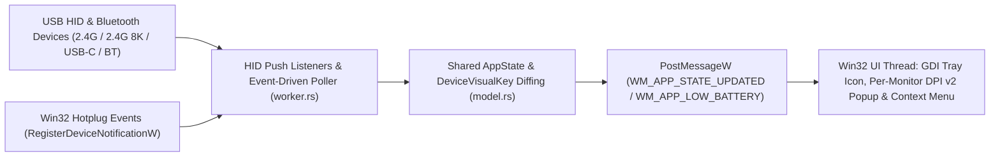

# Aula Battery

An ultra-lightweight, zero-runtime-dependency **native Windows system tray battery monitor** for wireless peripherals (**Aula F87** keyboard and **Aula SC900 Pro** mouse), written in pure **Rust** directly against the Win32 API (`windows-sys`).

No Electron, no WebView2, no heavy frameworks — just a single size-optimized native binary with sub-megabyte footprint and minimal idle CPU usage.

---

## Architecture



---

## Key Features

- **Pure Win32 Native Implementation:** Built directly on `windows-sys` (`Shell_NotifyIconW`, GDI dynamic icon rendering, DWM styling, `RegisterDeviceNotificationW` USB hotplug, single-instance `CreateMutexW`).
- **Multi-Transport Protocol Support:** Reads real-time battery level, charging state, and sleep/disconnect lifecycle across **2.4G**, **2.4G 8K**, **USB-C wired**, and **Bluetooth** connections via extensible `DeviceProvider` traits.
- **Event-Driven Background Workers:** Dedicated HID push-listener threads and `WaitForMultipleObjects`-backed polling wake immediately on device plug/unplug or manual refresh while staying idle in between.
- **Zero Redundant Redraws:** `DeviceVisualKey` equality diffing skips unnecessary GDI bitmap allocations and tray icon updates when visual state has not changed.
- **Per-Monitor DPI v2 & Low-Battery Alerts:** Crisp native popup on high-DPI displays, hysteresis-based low-battery notifications, and Windows Registry autostart toggle.
- **Aggressive Size Optimization:** Release profile configured with `opt-level = "z"`, LTO, `codegen-units = 1`, `strip = true`, and `panic = "abort"`.

---

## Project Structure

```text
src/
├── main.rs              # Win32 window loop, DPI awareness, hotplug & single-instance mutex
├── worker.rs            # HID push-listener threads + event-driven polling loop
├── model.rs             # DeviceState, ConnectionMode, visual diff key & alert hysteresis
├── settings.rs          # Persistent user preferences
├── autostart.rs         # Windows Registry startup integration
├── devices/             # DeviceProvider trait + Aula F87 & SC900 Pro providers
├── hid/                 # Win32 HID enumeration, RAII WinHandle & Bluetooth battery scan
├── protocol/            # Vendor-specific binary HID packet framing & parsing
└── ui/                  # Dynamic GDI tray icon, native popup window & context menu
```

---

## Building from Source

### Prerequisites

- **Windows 10/11**
- **Rust toolchain** (`rustup` / `cargo`, MSVC target)

```bash
# Type-check & verify build
cargo check

# Build size-optimized native Windows release binary
cargo build --release
```

The standalone executable is emitted at `target/release/aula-battery.exe`.

---

## License

MIT — see [`LICENSE`](LICENSE).
